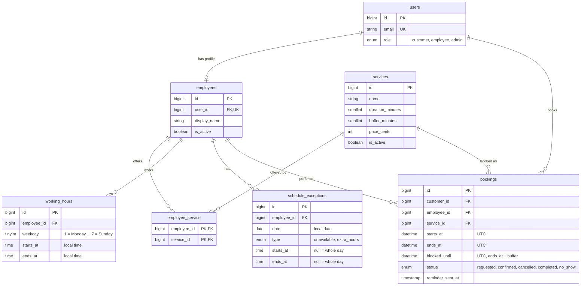

# BookingSystem

An appointment booking system for a small salon-style business, built with Laravel 12. Customers book a service with an employee at a free time. Employees see their agenda. An admin manages services, working hours and time off, and follows occupancy and no-shows.

The hard part, and the focus of the design, is that **two customers can never get the same time slot**, even when they click "book" at the same moment. See [Preventing double bookings](#preventing-double-bookings).

The user interface is in Dutch; code and documentation are in English.

## Features

| Role | What they can do |
|---|---|
| **Customer** (self-registration) | Book in four steps: service → employee → date → time, with live free times (`/bookings/create`). See, cancel and move their own bookings until the cancellation deadline (default 24 hours before). Receive a confirmation mail with an `.ics` file and a reminder about 24 hours before. |
| **Employee** | See their own agenda as a day or week grid with bookings, breaks, time off and public holidays (`/agenda`). |
| **Admin** | Manage services: duration, buffer, price, which employees perform them (`/admin/services`). Set weekly schedules with split shifts (`/admin/employees`) and exceptions: time off or extra hours. Open every agenda, cancel or move any booking, and see the overview with occupancy, no-show rate and counts per status (`/admin/bookings`). |

Other behaviour:
- Dutch public holidays are calculated in code (`config/holidays.php` decides which close the business).
- Daylight-saving nights are handled correctly: no slots in the skipped hour, both "02:30"s on the night the clock goes back.

## Tech stack

- PHP 8.2+, Laravel 12, Blade, Tailwind CSS 4 with Vite. The booking page uses a small amount of plain JavaScript (`resources/js/booking-flow.js`), no frontend framework.
- MySQL / MariaDB (InnoDB) as the database. The test suite runs on in-memory SQLite.
- Database queue for mail. The scheduler sends the hourly reminders.
- Pest, Larastan (level 6), Laravel Pint, GitHub Actions.

## Getting started

### Requirements

- PHP 8.2 or newer with `pdo_mysql` (and `pdo_sqlite` for the tests)
- Composer 2
- Node.js and npm
- MySQL 8 or MariaDB. For example XAMPP, which is what `.env.example` assumes: user `root`, no password.

### Install

1. Create an empty database `booking_system` in MySQL/MariaDB. To use different credentials, adjust the `DB_*` values in `.env` after the first step.
2. Run the setup script:

   ```bash
   composer setup
   ```

   `composer setup` installs the PHP and npm dependencies, copies `.env.example` to `.env` (if there is none yet), generates the app key, runs the migrations and builds the frontend assets.

### Create users

Registering on `/register` always creates a **customer**. There is no screen for creating admins or employees yet, so make them with Tinker (the factories need the dev dependencies; the password is `password`):

```bash
# An admin
php artisan tinker --execute="App\Models\User::factory()->admin()->create(['email' => 'admin@example.com']);"

# An employee (a user with the employee role plus an employees profile)
php artisan tinker --execute="App\Models\Employee::factory()->create(['user_id' => App\Models\User::factory()->employee()->create(['email' => 'medewerker@example.com'])->id, 'display_name' => 'Noor']);"
```

Then log in as the admin and do three things:
1. Create a service and tick the employees who perform it (*Beheer → Diensten*).
2. Give each employee a weekly schedule (*Beheer → Medewerkers en werkroosters*).
3. Register a customer on `/register` and book.

`php artisan db:seed` only creates a single customer, `test@example.com`.

### Run

```bash
composer dev
```

This runs, side by side:
- the web server (`php artisan serve`, http://localhost:8000),
- a queue worker (`php artisan queue:listen`, needed for the confirmation and reminder mails),
- the log viewer (`php artisan pail`),
- Vite (`npm run dev`).

Mail goes to the log by default (`MAIL_MAILER=log`, see `storage/logs/laravel.log`).

The reminders come from the scheduled command `bookings:send-reminders` (hourly). `composer dev` does not run the scheduler. Start it in a separate terminal:

```bash
php artisan schedule:work
```

Or run the command once by hand: `php artisan bookings:send-reminders`.

### Configuration

Booking rules in `.env` (see `config/booking.php`):

| Variable | Default | Meaning |
|---|---|---|
| `BOOKING_SLOT_INTERVAL` | `15` | Minutes between offered start times |
| `BOOKING_CANCELLATION_WINDOW_HOURS` | `24` | Until how many hours before the start a customer may cancel or move |
| `BOOKING_REMINDER_HOURS_BEFORE` | `24` | How long before the start the reminder goes out |

## Tests and quality checks

```bash
composer test                         # Pest test suite on in-memory SQLite
vendor/bin/pest --coverage --min=80   # with coverage; needs PCOV or Xdebug
vendor/bin/phpstan analyse            # Larastan, level 6
vendor/bin/pint --test                # code style
```

The concurrency test (`tests/Concurrency/ConcurrentBookingTest.php`) needs real row locks, so it is skipped on SQLite. To run it locally, point the tests at a MySQL test database. Real environment variables override the SQLite defaults in `phpunit.xml`:

```bash
DB_CONNECTION=mysql DB_DATABASE=booking_test DB_USERNAME=root DB_PASSWORD= vendor/bin/pest
```

CI (`.github/workflows/ci.yml`) runs on every push:
- Pint and Larastan,
- the tests on PHP 8.2, 8.3 and 8.4,
- a coverage job that fails below 80% (repository variable `COVERAGE_MIN`),
- the full suite against MySQL 8, including the concurrency test.

## Domain model (ERD)

Main tables and relations. The full diagram with every column, plus the indexes, is in [docs/erd.md](docs/erd.md).



## Key design choices

All decisions, with their reasons and trade-offs, are in [docs/decisions.md](docs/decisions.md). The domain rules are in [docs/erd.md](docs/erd.md). The most important ones:

### Preventing double bookings

MySQL has no constraint that can forbid overlapping time ranges; PostgreSQL's exclusion constraint has no MySQL equivalent. Overlap is therefore prevented in the application, in `App\Bookings\CreateBooking`. The checks and the insert run in **one database transaction**:

1. **Lock first.** Lock the employee's `employees` row, then the customer's `users` row, with `SELECT ... FOR UPDATE` (`lockForUpdate()`).
2. **Check again, inside the lock.**
   - The employee has no `requested`/`confirmed` booking overlapping the new `starts_at` up to `blocked_until`, buffer included.
   - The customer has no other appointment at that time, with any employee.
   - The start is one of the offered free slots.
3. **Insert** the booking and commit.

Why this works:

- **Requests for the same employee or customer queue up.** A second request waits at step 1 until the first commits. It then sees the new booking and is refused with a normal message ("Dit tijdstip is helaas net bezet"). The booking page answers this with HTTP 409 and reloads the free times. Exactly one of the two requests succeeds.
- **Other employees are not held up.** The lock is per employee row, not on the whole `bookings` table.
- **No deadlocks.** The lock order is fixed: employee first, then customer. Moving a booking takes the same two locks and then the booking row; cancelling only locks the booking row. The waits can never form a cycle.
- **The locks must be the first queries in the transaction.** InnoDB takes its REPEATABLE READ snapshot at the first plain read, so reading before the lock could miss a booking that was just committed.
- **The overlap check is one indexed range comparison.** Every booking stores `blocked_until = ends_at + buffer`, so the check is `existing.starts_at < new.blocked_until AND existing.blocked_until > new.starts_at`, served by the `(employee_id, starts_at)` index. Only `requested` and `confirmed` bookings block time; cancelling frees the slot.
- **The free times shown and the booking check use the same rule** (`Booking::blockingBetween()`), so an offered slot is never refused for overlap unless someone else just took it.
- **It is tested for real.** `tests/Concurrency/ConcurrentBookingTest.php` replays the race with simultaneous requests. SQLite ignores `lockForUpdate()`, so this test runs against MySQL 8 in CI.

Moving a booking (`RescheduleBooking`) updates the same row in place, inside the same kind of locked transaction. The old time stays taken until the new one is committed, and a refused move changes nothing.

### Time zones: store UTC, schedule in local time

Bookings are stored in UTC. Working hours and exceptions are stored as local wall-clock time (`Europe/Amsterdam`), so "09:00-17:00 on Mondays" stays 09:00 across daylight-saving changes. `App\Scheduling\LocalTime` is the single place that converts between the two. Booking input carries a numeric offset (`2026-10-25T02:30:00+01:00`), so a time in the repeated autumn hour is never ambiguous.

### Other choices

- **Snapshots:** a booking copies `duration_minutes` and `price_cents` from the service, so editing a service never rewrites history.
- **Deactivate, don't delete:** services and employees with bookings are deactivated; foreign keys from `bookings` are `RESTRICT`.
- **Status state machine:** `requested → confirmed → completed / no_show`, and `cancelled` from requested or confirmed. Enforced on every save of a `Booking`.
- **Authorization:** a `role` middleware guards whole areas, and policies decide per record. A record you may not see answers 404, not 403, so ids cannot be probed.
- **Mail after commit:** confirmation and reminder mails are queued jobs dispatched after the transaction commits, so a refused booking never sends mail. Each reminder is claimed with a conditional `UPDATE`, so no customer gets it twice.
- **Server-rendered first:** the booking page works without JavaScript; the script only makes it faster. The agenda is a CSS grid rendered on the server.

## Project layout

| Path | Contents |
|---|---|
| `app/Bookings/` | Use cases without HTTP: `CreateBooking`, `CancelBooking`, `RescheduleBooking`, `QueueBookingReminders`, the `.ics` builder |
| `app/Scheduling/` | Availability: `SlotCalculator` (pure, unit tested), `AvailableSlots`, `DaySchedule`, `DutchHolidays`, `LocalTime`, `Agenda`, `Occupancy` |
| `app/Http/Controllers/` | Thin controllers for customers, the agenda and `Admin/` |
| `app/Policies/` | `BookingPolicy`, `EmployeePolicy` |
| `app/Jobs/`, `app/Mail/` | Queued confirmation and reminder mails |
| `database/migrations/` | Schema (see the ERD) |
| `routes/web.php`, `routes/console.php` | Routes; the hourly reminder schedule |
| `tests/Unit`, `tests/Feature`, `tests/Concurrency` | Pest tests |
| `docs/` | [erd.md](docs/erd.md), [decisions.md](docs/decisions.md) |

## Screenshots

There are no screenshots yet. To make them, follow [Create users](#create-users): add an admin, two employees with a weekly schedule, a few services and some bookings. Capture `/bookings/create`, `/agenda` (week view) and `/admin/bookings`, and save them in `docs/screenshots/`.
