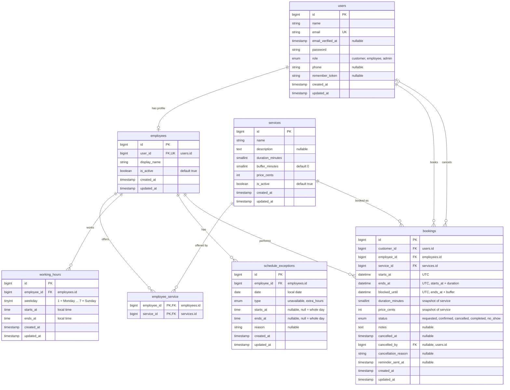

# Domain model (ERD)

Design of the database schema, written before the first migration. See [decisions.md](decisions.md) for the choices behind it (MySQL/InnoDB, UTC storage).



## Entities

| Table | Purpose |
|---|---|
| `users` | Everyone who can log in. `role` decides what they may do (customer, employee, admin). |
| `employees` | Profile for users with the employee role: who can be booked. Kept separate so login data and "bookable resource" data do not mix. |
| `services` | What can be booked: duration, buffer after the appointment, price. |
| `employee_service` | Which employee can perform which service (many-to-many). |
| `working_hours` | Recurring weekly schedule. Several rows per employee per weekday allow split shifts (e.g. 09:00-12:30 and 13:30-17:00). |
| `schedule_exceptions` | One-off deviations for a date: time off, holidays (`unavailable`) or extra hours (`extra_hours`). They override `working_hours` for that date. |
| `bookings` | An appointment: one customer, one employee, one service, one time range. |

## Design decisions

### Two kinds of time
- `working_hours` and `schedule_exceptions` store **local wall-clock time** (`TIME`/`DATE` in `Europe/Amsterdam`). "Works 09:00-17:00 on Mondays" must stay 09:00-17:00 across daylight-saving changes, which UTC would break.
- `bookings` store **UTC** (`DATETIME`). A booking is a concrete moment in time.
- The slot calculation (ISSUE-11) converts the local schedule into concrete UTC ranges for a given date, and ISSUE-14 covers the switch weekends.

### `blocked_until` instead of computing the buffer
The overlap check has to be a simple, indexable range comparison. Storing `blocked_until = ends_at + buffer` means two bookings of the same employee overlap when:

```
existing.starts_at < new.blocked_until AND existing.blocked_until > new.starts_at
```

The customer's own double-booking check uses `starts_at`/`ends_at` only, because a buffer is the employee's cleanup time, not the customer's.

### Snapshots on the booking
`duration_minutes` and `price_cents` are copied from the service at booking time. Changing a service later must not rewrite history or move existing appointments.

### Which bookings block a slot
`requested` and `confirmed` block their time range. `cancelled` frees it. `completed` and `no_show` are in the past and never block new bookings. Allowed status transitions are defined in ISSUE-18.

### Which employee can perform which service
`employee_service` links employees to the services they can perform (ISSUE-8). Admins set the links on the service form; an unchecked employee is unlinked. The form only accepts existing employees, each once, and the composite primary key rejects duplicates in the database as well.

An employee can be booked for a service only when `Employee::canPerform($service)` is true: the employee is active and linked to the service. `Employee::active()->offering($service)` returns the employees to offer for a service. The slot calculation (ISSUE-11) and booking creation (ISSUE-12) must use these, so a request for an unlinked or inactive employee is rejected server side.

Unlinking an employee does not touch existing bookings; it only prevents new ones. An active service without an active linked employee cannot be booked, and the admin service overview warns about that.

### Weekly schedule
`working_hours` holds the recurring week of each employee (ISSUE-9). Admins edit it under *Beheer → Medewerkers en werkroosters* (`/admin/employees`).

- **Weekdays** are ISO-8601 numbers, 1 = Monday ... 7 = Sunday (`App\Enums\Weekday`, `Weekday::fromDate()`), the same as PHP's `N` format.
- **Blocks:** a day can have up to six blocks; a lunch break is two blocks (09:00-12:30 and 13:30-17:00). A weekday without blocks is a day off.
- **Rules** (checked in `ScheduleRequest`): times are `HH:MM` local time; a block ends after it starts on the same day (no night shifts past midnight, latest end 23:59); blocks on one day do not overlap, but may touch (12:00-12:00).
- **Saving** replaces the whole schedule of that employee in one transaction. Existing bookings are not touched: a booking outside the new hours stays, it is only no longer offered as a new slot.
- **Storage:** times are written as `HH:MM:00` and read as `HH:MM`, so SQLite and MySQL behave the same.

For a concrete date, use `Employee::scheduleOn($localDate)` (see *Schedule exceptions and public holidays* below), not `workingHoursOn()` directly.

### Schedule exceptions and public holidays
`schedule_exceptions` holds one-off deviations per employee and date (ISSUE-10). Admins manage them under *Beheer → Medewerkers → Uitzonderingen* (`/admin/employees/{employee}/exceptions`).

- **Types:** `unavailable` (leave, sick, dentist) for the whole day (both times empty) or for a time range; `extra_hours` always with a time range.
- **Ranges of days:** the form accepts a start date and an optional end date (at most 62 days). This creates one row per day, so every row stays a single date and deleting one day of a holiday is easy.
- **Rules** (checked in `ScheduleExceptionRequest`): dates are `Y-m-d` and not in the past (today in `Europe/Amsterdam`); times are `HH:MM` and the end is after the start. Overlapping exceptions are allowed, because the result is merged anyway and is shown per date on the admin page.
- **Dutch public holidays** are calculated in code (`App\Scheduling\DutchHolidays`: fixed dates, Easter-based dates, Koningsdag on 26 April when the 27th is a Sunday), not stored. `config/holidays.php` lists which holidays close the business; by default all of them except Goede Vrijdag and Bevrijdingsdag.
- **Storage:** `date` is written as `Y-m-d` and read as midnight `Europe/Amsterdam`; times as for `working_hours`.

`Employee::scheduleOn($localDate)` returns an `App\Scheduling\DaySchedule` with the working time of that date as sorted, non-overlapping `TimeRange`s (minutes since midnight). Precedence, from low to high:

1. the weekly schedule for that weekday;
2. a closed public holiday clears the weekly hours;
3. `extra_hours` are added, also on a holiday (this is how someone works on Koningsdag);
4. `unavailable` is removed last and always wins.

Exceptions do not touch existing bookings: a booking on a new day off stays and must be moved or cancelled by hand. The slot calculation (ISSUE-11) starts from `scheduleOn($localDate)->ranges`, subtracts existing bookings and converts to UTC (ISSUE-14). Pass a local date: `scheduleOn()` only looks at the calendar date of its argument. When computing many dates, eager load `workingHours` and `scheduleExceptions` to avoid a query per day.

### Deleting data
Employees and services are **deactivated** (`is_active = false`), not deleted, because bookings reference them. Foreign keys from `bookings` use `RESTRICT` on delete. Deleting a user is out of scope for now. `employee_service`, `working_hours` and `schedule_exceptions` cascade when their employee is deleted; `employee_service` also cascades when a service (without bookings) is deleted.

## Indexes

| Table | Index | Used for |
|---|---|---|
| `users` | unique `email` | login |
| `employees` | unique `user_id` | one profile per user |
| `employee_service` | primary `(employee_id, service_id)` | prevents duplicates, lookup by employee |
| `employee_service` | `service_id` | lookup by service |
| `working_hours` | `(employee_id, weekday)` | weekly schedule per day |
| `schedule_exceptions` | `(employee_id, date)` | exceptions for a day |
| `bookings` | `(employee_id, starts_at)` | overlap check and agenda view |
| `bookings` | `(customer_id, starts_at)` | customer overview and double-booking check |
| `bookings` | `(status, starts_at, reminder_sent_at)` | reminder job (ISSUE-20) |

## Concurrency

Preventing double bookings (ISSUE-13) is done in the application, because MySQL has no exclusion constraint for time ranges. Creating a booking runs in one transaction that:

1. locks the employee row (`SELECT ... FOR UPDATE`, `lockForUpdate()`),
2. re-checks for overlap with the query above,
3. inserts the booking.

Locking the `employees` row serialises bookings per employee without blocking other employees.

## Open points

- **Cancellation window** (ISSUE-16) is a single global value, so it lives in config for now. If it must differ per service it becomes a column on `services`.
- **Status history** (who changed what, when) is not modelled. If it turns out to be needed for ISSUE-18, add a `booking_status_changes` table.
