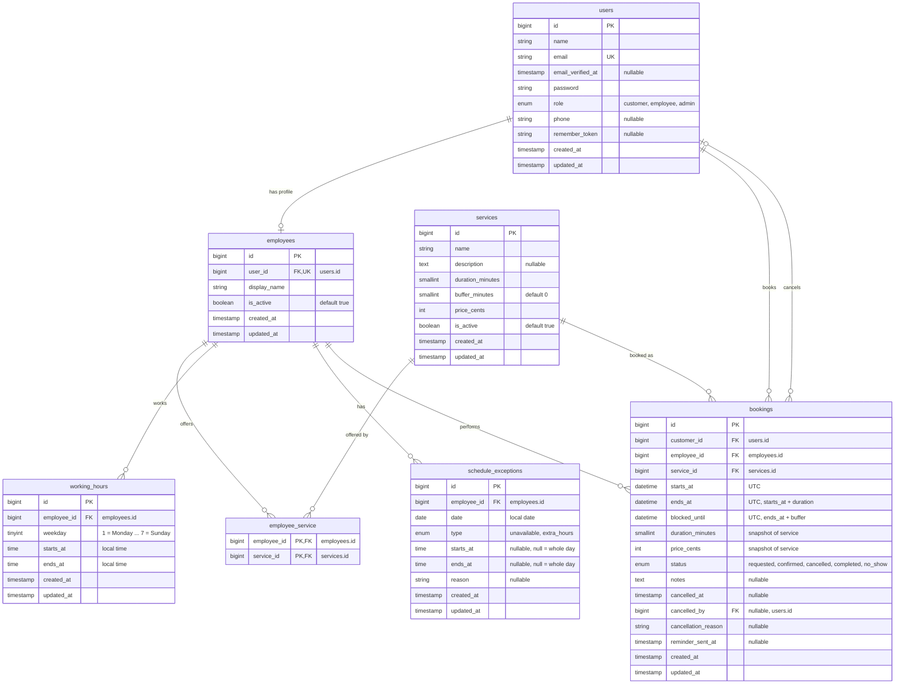

# Domain model (ERD)

Design of the database schema, written before the first migration. See [decisions.md](decisions.md) for the choices behind it (MySQL/InnoDB, UTC storage).



## Entities

| Table | Purpose |
|---|---|
| `users` | Everyone who can log in. `role` decides what they may do (customer, employee, admin). |
| `employees` | Profile for users with the employee role: who can be booked. Kept separate so login data and "bookable resource" data do not mix. |
| `services` | What can be booked: duration, buffer after the appointment, price. |
| `employee_service` | Which employee can perform which service (many-to-many). |
| `working_hours` | Recurring weekly schedule. Several rows per employee per weekday allow split shifts (e.g. 09:00-12:30 and 13:30-17:00). |
| `schedule_exceptions` | One-off deviations for a date: time off, holidays (`unavailable`) or extra hours (`extra_hours`). They override `working_hours` for that date. |
| `bookings` | An appointment: one customer, one employee, one service, one time range. |

## Design decisions

### Two kinds of time
- `working_hours` and `schedule_exceptions` store **local wall-clock time** (`TIME`/`DATE` in `Europe/Amsterdam`). "Works 09:00-17:00 on Mondays" must stay 09:00-17:00 across daylight-saving changes, which UTC would break.
- `bookings` store **UTC** (`DATETIME`). A booking is a concrete moment in time.
- The slot calculation (ISSUE-11) converts the local schedule into concrete UTC ranges for a given date, and ISSUE-14 covers the switch weekends.

### `blocked_until` instead of computing the buffer
The overlap check has to be a simple, indexable range comparison. Storing `blocked_until = ends_at + buffer` means two bookings of the same employee overlap when:

```
existing.starts_at < new.blocked_until AND existing.blocked_until > new.starts_at
```

The customer's own double-booking check uses `starts_at`/`ends_at` only, because a buffer is the employee's cleanup time, not the customer's.

### Snapshots on the booking
`duration_minutes` and `price_cents` are copied from the service at booking time. Changing a service later must not rewrite history or move existing appointments.

### Which bookings block a slot
`requested` and `confirmed` block their time range. `cancelled` frees it. `completed` and `no_show` are in the past and never block new bookings. Allowed status transitions are defined in ISSUE-18.

### Deleting data
Employees and services are **deactivated** (`is_active = false`), not deleted, because bookings reference them. Foreign keys from `bookings` use `RESTRICT` on delete. Deleting a user is out of scope for now. `employee_service`, `working_hours` and `schedule_exceptions` cascade when their employee is deleted.

## Indexes

| Table | Index | Used for |
|---|---|---|
| `users` | unique `email` | login |
| `employees` | unique `user_id` | one profile per user |
| `employee_service` | primary `(employee_id, service_id)` | prevents duplicates, lookup by employee |
| `employee_service` | `service_id` | lookup by service |
| `working_hours` | `(employee_id, weekday)` | weekly schedule per day |
| `schedule_exceptions` | `(employee_id, date)` | exceptions for a day |
| `bookings` | `(employee_id, starts_at)` | overlap check and agenda view |
| `bookings` | `(customer_id, starts_at)` | customer overview and double-booking check |
| `bookings` | `(status, starts_at, reminder_sent_at)` | reminder job (ISSUE-20) |

## Concurrency

Preventing double bookings (ISSUE-13) is done in the application, because MySQL has no exclusion constraint for time ranges. Creating a booking runs in one transaction that:

1. locks the employee row (`SELECT ... FOR UPDATE`, `lockForUpdate()`),
2. re-checks for overlap with the query above,
3. inserts the booking.

Locking the `employees` row serialises bookings per employee without blocking other employees.

## Open points

- **Cancellation window** (ISSUE-16) is a single global value, so it lives in config for now. If it must differ per service it becomes a column on `services`.
- **Dutch public holidays** (ISSUE-10) are not stored in a table. They are calculated in code and turned into `unavailable` exceptions, so employees can still opt in to work on a holiday.
- **Status history** (who changed what, when) is not modelled. If it turns out to be needed for ISSUE-18, add a `booking_status_changes` table.
